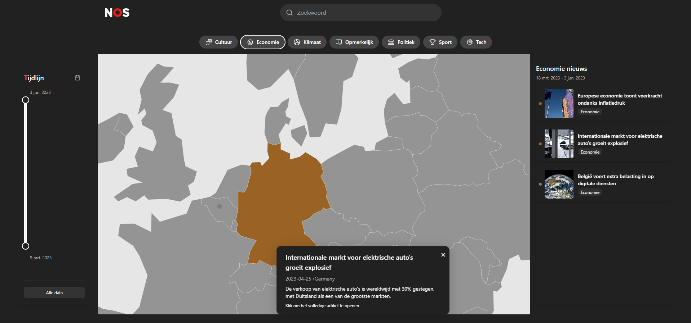

# NOS Globe


---

## 🌍 Overview

**NOS Globe** is an interactive, globe-based news interface developed for the Fontys Mindlabs hackathon in collaboration with NOS. The app visualizes global news stories per region using data-driven markers and an immersive globe experience. Users can explore categorized articles, filter them by theme, and navigate easily across the world to see what’s happening where and why it matters.

---

## 🖼️ Screenshot



---

## 🔧 Setup Instructions

### 1. Clone the Repository

```bash
git clone https://github.com/cindybruikman/nos-globe.git
cd nos-globe
```

### 2. Install Dependencies

```bash
npm install
```

### 3. Start the App

```bash
npm run dev
```

Visit: [http://localhost:3000](http://localhost:3000)

---

## 🛠 Scripts

| Command         | Description              |
| --------------- | ------------------------ |
| npm run dev     | Run local dev server     |
| npm run build   | Build for production     |
| npm run lint    | Lint the code            |
| npm run preview | Preview production build |

---

## 💡 Key Features

- Interactive D3-powered 3D globe with zoom and drag
- News articles visualized as location-based pins
- Filter by categories like politics, culture, sports, and more
- Timeline component for temporal filtering
- Accessible and responsive dark-mode UI

---

## 🎓 Hackathon Context

This project was built during a two-day hackathon organized by Fontys Mindlabs and NOS. The challenge:  
> "How can we present foreign news in an immersive, engaging way?"

The result: a data-rich, intuitive news globe designed to make exploration rewarding.

---

## 📄 License

MIT License
